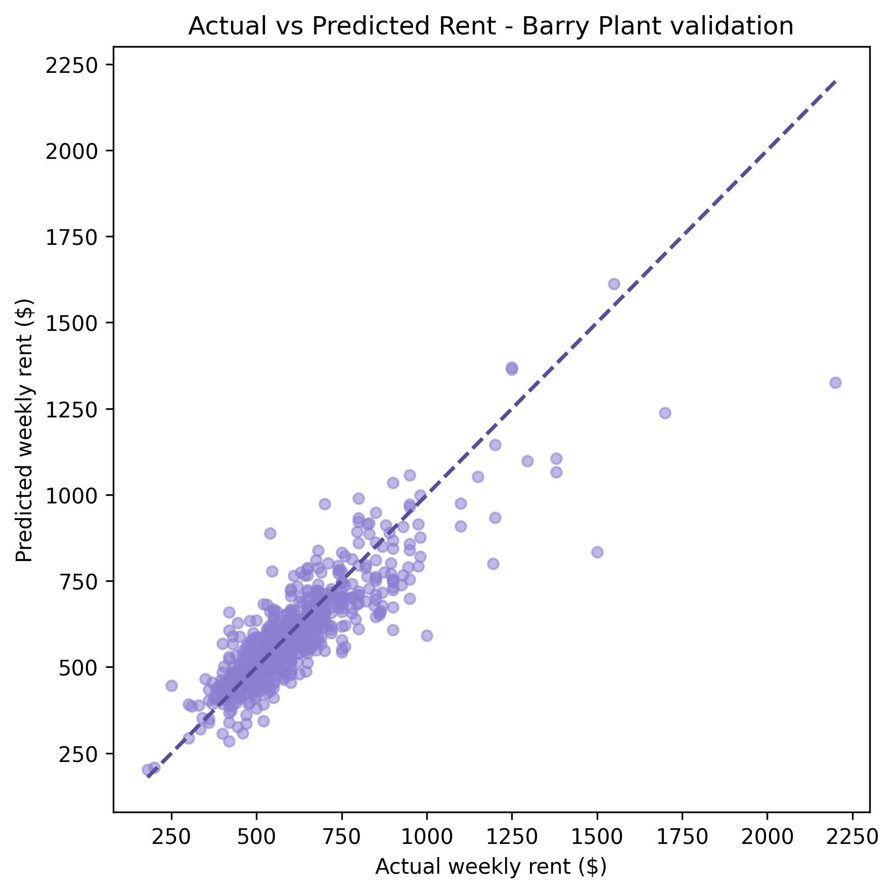
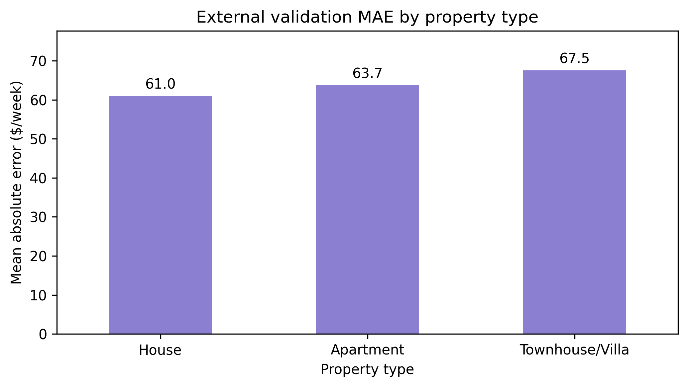

# Victorian Rental Data Integration and External Validation

## 中文概览

**项目定位：租赁数据分析 / 多源数据整合 / 模型外部验证。** 检查基于 Domain 房源训练的租金模型，在另一平台 Barry Plant 的房源上能否保持预测表现。

- **个人贡献**：房源采集与处理、建模表整合、外部验证及项目复现整理；有提交记录佐证。主要租金模型开发、最初的空间特征和区域排名属于团队工作。
- **技术栈**：Python、pandas、地理数据处理、网页数据采集、scikit-learn、Jupyter。
- **原项目保存结果**：719 条外部房源，MAE 为 **62.61 澳元/周**、RMSE 为 92.70、R² 为 0.728；这是历史评估输出，本轮整理未重新训练或调用采集/API 流程。
- **业务解释**：比较跨平台误差并检查物业类型差异；目标是挂牌周租金，不是成交租金或投资回报。未来租金情景推算不作为本人的已验证预测成果。

## English documentation

**Can a rental-price model trained on one listing platform transfer to another?**

A contribution-focused portfolio from a team Victorian rental-analysis project. My work connects **web data collection, multi-source integration and external model validation**, with results from 719 Barry Plant rental listings.

**Tools:** Python, pandas, geospatial features, web collection, scikit-learn and reproducible Jupyter workflows.

## My contribution

I contributed Barry Plant data collection/processing, modelling-table integration, supplementary external validation and project workflow documentation. These contributions are supported by [commit evidence](docs/CONTRIBUTIONS.md). The core rent model was developed by a teammate; this repository does not present its development as my individual work.

## Saved project results

| Evaluation | Source and role | MAE, weekly dollars | RMSE | R-squared |
| --- | --- | ---: | ---: | ---: |
| Internal held-out test | Main Domain team model | 74.82 | 155.42 | 0.680 |
| Out-of-platform evaluation, 719 listings | Barry Plant validation workflow | 62.61 | 92.70 | 0.728 |

The selected model is Gradient Boosting on log1p weekly asking rent. Predictions are transformed back to weekly dollars for evaluation. These numbers are taken from the upstream saved output, not newly retrained metrics. Lower external MAE does not prove better transfer: the platforms, dates, property mix and rent distributions differ.

## Workflow and repository

- `code/04_modelling_table.ipynb`: integrate team-cleaned listings and area/location features.
- `code/08_plant_scraper.ipynb`: collect supplementary Barry Plant listings.
- `code/09_plant_processing.ipynb`: harmonise external listings and construct compatible features.
- `code/10_plant_external_validation.ipynb`: restore the selected pipeline, align inputs, predict without fitting preprocessing to the external set, and diagnose errors.
- `scripts/build_train_stations.py`: station-location preparation helper.
- `DATA_CONTRACTS.md`: upstream team data interfaces, retained for context.
- `docs/REPRODUCE.md`: required inputs and execution scope.

## Reproduce

Create the environment from `environment.yml`. Execute the notebooks with `code/` as kernel working directory, using the prerequisite tables listed in the reproduction notes. A full rerun requires authorised upstream Domain inputs, external geographic sources, collected Barry Plant features and a local routing key. None of those listing-level data, model binaries, raw downloads or credentials are redistributed in this portfolio copy.

This folder is a source-and-results presentation, not a self-contained data bundle. The original repository contains the wider team workflow. Local code cells pass syntax checks; network scraping, paid/quota-limited routing, model reconstruction and external evaluation were not rerun for this portfolio edition.

## Interpretation and limitations

- The target is advertised weekly asking rent, not signed-lease rent or capital returns.
- Out-of-platform results describe this available listing sample, not every Victorian rental property.
- Geographic and demographic features are proxies; area-level data do not describe individual tenants.
- The original fallback rebuilds the team's selected model from hard-coded parameters if the saved artifact is absent. The upstream artifact is not automatically refreshed when the training table changes; a fresh evaluation should verify model/data provenance.
- No future-rent growth forecast is claimed here. The team's projection is a separate scenario model with an acknowledged annualisation-interval issue, so it is not used as a headline individual achievement.

## Provenance

Adapted from the private team repository [ADS_project2](https://github.com/sophiaaaaaa123/ADS_project2), reviewed through snapshot `1e758b2fb24b82675eb7895d16bf983e1b0630de`. Team attribution and course origin are retained. Review the original course and third-party source terms before public redistribution. No new licence is assigned.
